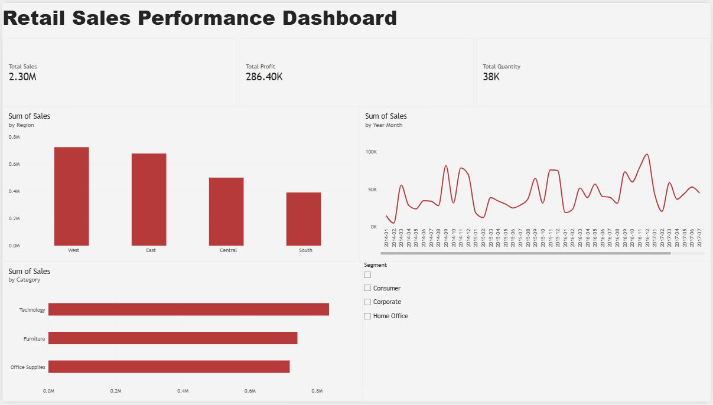

# Retail Sales Analytics

An end-to-end retail sales analysis project using **MySQL, Excel, and Power BI**. The project explores sales, profit, quantity, category performance, regional performance, and monthly sales trends through SQL queries and an interactive Power BI dashboard.

## Dashboard Preview



## Project Files

```text
Retail-Sales-Analytics/
├── README.md
├── Dataset/
│   └── retail_sales.csv
├── PowerBI/
│   └── Retail_Sales_Analytics_Dashboard.pbix
├── SQL/
│   └── retail_sales_analysis.sql
└── Screenshots/
    └── dashboard_overview.png
```

## Tools Used

- **MySQL:** Data inspection, aggregation, grouping, filtering, and analytical queries.
- **Power BI:** DAX measures, KPI cards, charts, monthly trend analysis, and an interactive Segment slicer.
- **Excel:** Supporting data analysis and exploration.

## Dataset

The supplied CSV contains **9,994 records and 9 columns**.

The analysis uses fields including Order Date, Region, State, Category, Sub-Category, Segment, Sales, Profit, and Quantity.

## Dashboard Components

- KPI cards for Total Sales, Total Profit, and Total Quantity.
- Sales by Category.
- Sales by Region.
- Monthly Sales Trend.
- Segment slicer for Consumer, Corporate, and Home Office.

## Key Findings

- **Technology** is the highest-sales category.
- **West** is the highest-sales region.
- The dashboard allows users to explore performance by customer segment and observe monthly sales variation.

## Verified Overall Metrics

The overall totals below were checked against the MySQL aggregate query and matched the Power BI KPI cards:

| Metric | Value |
|---|---:|
| Total Sales | 2,297,200.86 |
| Total Profit | 286,397.02 |
| Total Quantity | 37,873 |
| Records | 9,994 |

## SQL Analysis

The SQL script includes queries for:

- Row counts and sample records.
- Sales totals by category and region.
- Overall sales, profit, and quantity.
- Table structure inspection.
- Loss-making transactions.
- Regional sales filtering with `HAVING`.
- An illustrative `region_targets` table for practice.

**Note:** The `region_targets` values in the SQL script are sample values created for analysis practice; they are not actual business targets.

## How to View

1. Open the `.pbix` file using Power BI Desktop.
2. Run the SQL script in MySQL Workbench after placing the dataset in a MySQL table named `sales_data` in the `retail_analytics` database.
3. Use the Segment slicer in Power BI to filter the dashboard.

## Author

**Kavya Veerapur**
